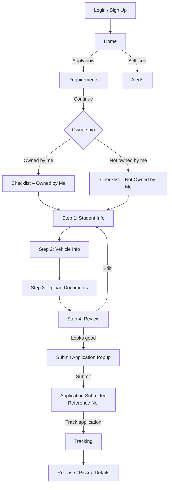

# ParSU Motopass — Online Student Motor Sticker Request Form

> Markdown version of `MIDPROJ_Cleofe-Surname2_BSCS3A.docx`.

---

## Part I – Planning

### Proposed Application Title

**Online Student Motor Sticker Request Form**

### Background and Problem

Motorcycles are commonly used by students as a convenient way to travel to and from school. To maintain safety and organized parking, students may be required to register their motorcycles and obtain a motor sticker. However, the current process may still involve manual forms and face-to-face submission, making the process time-consuming and inconvenient.

The current process presents several challenges, including:

- **Manual submission of forms** requires students to fill out and submit physical documents.
- **Long processing time** may occur when personnel handle many requests manually.
- **Difficulty in tracking requests** makes it harder for students to know the status of their applications.
- **Paper-based records** can be difficult to organize and may be misplaced or contain incomplete information.

These problems affect both students and school personnel. An Online Student Motor Sticker Request Form can provide a faster and more organized way to submit and manage requests. It can reduce paperwork, save time, and make the process more convenient for everyone involved.

### Proposed Solution

The proposed Online Student Motor Sticker Request Form will provide a simple online platform where students can submit their motor sticker requests without filling out physical forms or going to the office. The application will allow students to enter their personal and motorcycle information, upload the needed requirements, and check the status of their request.

For school personnel, the system will help organize and manage submitted requests in one place, making it easier to review student information and process applications. This can reduce paperwork, minimize errors, save time, and make the motor sticker request process more convenient and organized.

### Target Users and Stakeholders

The application is intended for students who need to request a motor sticker and school personnel who manage and process these requests. The following are the primary users and stakeholders:

- **Students** – The main users who will submit their motor sticker requests, provide the required information, and check the status of their applications.
- **School Personnel** – Responsible for reviewing, verifying, and processing the submitted motor sticker requests.
- **School Administration** – Uses the records and information from the application to help monitor and manage motorcycle registration within the school.
- **Security Personnel** – May use the motor sticker records to help identify registered motorcycles and maintain proper parking and security on campus.

### Project Objectives

#### General Objective

To develop an online student motor sticker request form that provides a convenient, organized, and efficient way for students to submit and manage their motor sticker applications.

#### Specific Objectives

1. To identify the needs and requirements of students regarding the motor sticker request process.
2. To design a simple and user-friendly online motor sticker request form for students.
3. To develop an online system that allows students to submit their motor sticker requests and required information electronically.

### Scope and Limitations

**What the app will do:**

- Let students create an account and log in.
- Let students fill out an online motor sticker request form.
- Collect necessary student and vehicle information.
- Show the requirements needed for a motor sticker application.
- Allow students to upload required files or photos.
- Allow students to review the application before submitting.
- Generate a request/reference number.
- Show the status of the application.
- Send notifications about application updates.
- Allow authorized staff to review and update applications.
- Keep a record of submitted applications.

**What the app will NOT do:**

- It will not automatically approve motor sticker applications.
- It will not replace the school's official security or registration process.
- It will not issue a sticker without staff verification.
- It will not create or modify official vehicle registration documents.
- It will not allow students to access another student's application.
- It will not guarantee approval of an application.
- It will not process incomplete applications as approved.

### Resources and Tools

- **People:** My partner and a few students who use motorcycles or other vehicles on campus.
- **School Information:** Sample motor sticker requirements and application information.
- **Devices:** Smartphone or emulator for testing.
- **Software:** Figma for UI/UX design and Flutter for possible application development.
- **Testing Information:** Sample student and vehicle information for prototype testing.

### Risks and Mitigation

| Risk | What We Will Do About It |
|------|--------------------------|
| Students may enter incorrect vehicle information. | Add a review page before final submission. |
| Students may forget required documents. | Display a clear checklist and required-file indicators. |
| Uploaded files may be unclear. | Show upload instructions and allow students to replace files before submitting. |
| Students may not know their application status. | Provide a simple tracking page with clear status labels. |
| Unauthorized people may access student information. | Use login and role-based access for student and staff accounts. |
| Students may have difficulty using the form. | Keep the form short, organized, and easy to understand. |

---

## Part II – Requirements Gathering and Analysis

### Research Methodology

This chapter presented the research methodology that was used in the study. The researchers used interviews, observation, and review of the existing motor sticker request process to identify the user's needs. The gathered information was analyzed to determine the requirements of the proposed Online Student Motor Sticker Request Form.

### Respondents or Information Sources

The respondents and information sources of this study will include students who are applying for or requesting a motor sticker, as they are the primary users of the proposed Online Student Motor Sticker Request Form. Their experiences and feedback will help identify the difficulties they encounter in the existing motor sticker request process, such as submitting requirements, providing vehicle information, and checking the status of their requests. School security personnel will also be considered as information sources because they are responsible for checking and validating motor stickers and monitoring vehicles entering and leaving the school premises. Administrative personnel or staff involved in processing motor sticker applications will also provide information regarding the current procedures, required documents, approval process, and record management.

The study will also consider existing school policies, guidelines, forms, and procedures related to motor sticker applications as supporting information sources. These materials will help the researchers understand the existing process and determine the necessary information and features that should be included in the proposed online system. The information gathered from the respondents and existing school procedures will be used to identify user requirements and develop a more organized, accessible, and efficient online motor sticker request process.

### Summary of Findings

The findings of the study showed that the current motor sticker request process may be time-consuming and inconvenient for students due to the need to personally submit forms and requirements. Students need a simpler and more accessible way to submit their motor sticker requests without having to repeatedly visit the office. They also expect a clear and organized process where they can easily provide the required information, upload necessary documents, and receive updates regarding their request.

The study also found that school personnel need a more organized method of managing and reviewing submitted motor sticker requests. Manual processing and record-keeping may make it difficult to track applications, verify information, and monitor the status of requests. Security personnel also need an efficient way to identify approved motor stickers and ensure that only authorized vehicles are allowed on campus.

Based on these findings, the proposed Online Student Motor Sticker Request Form should provide a convenient and user-friendly platform for submitting requests, organizing applicant information, reviewing requirements, and monitoring request status. The system is expected to reduce unnecessary paperwork, improve the processing of requests, and make the overall motor sticker application process more organized and efficient for both students and school personnel.

### User Roles

| User Role | What They Need to Do |
|-----------|----------------------|
| Student | Fill out the motor sticker form, upload requirements, submit the request, track status, and receive notifications. |
| School Personnel | Review student applications, verify requirements, approve/reject requests, update status, and prepare stickers for release. |
| Administrator | Manage users, requirements, sticker information, and application records. |
| Security Personnel | May use the motor sticker records to help identify registered motorcycles and maintain proper parking and security on campus. |

### Functional Requirements

1. The application shall allow students to submit motor sticker requests online.
2. The application shall allow students to provide and upload the required information and documents.
3. The application shall allow students to view the status of their motor sticker requests.
4. The application shall allow authorized staff to review and verify submitted requests.
5. The application shall allow authorized staff to approve or reject motor sticker requests.
6. The application shall allow authorized staff to manage and keep records of submitted motor sticker requests.

### Non-Functional Requirements

- **Usability** – The application shall be simple enough for students to complete the motor sticker form in a few minutes.
- **Performance** – The application shall load the form and application status quickly.
- **Reliability** – Submitted application information shall remain saved when the app is closed.
- **Security** – Student and vehicle information shall only be accessible to authorized users.
- **Accessibility** – The application shall use readable text, clear buttons, and understandable icons.
- **Compatibility** – The design shall support common Android smartphones and can later be adapted for iPhone.
- **Privacy** – The application shall collect only information needed for the motor sticker application.

---

## Part III – Design

The prototype is named **ParSU Motopass** (Motor sticker application). The flow, screens, and layout below follow the Figma design.

### Core User Flow

**Student Flow:**

1. Open the app and log in with Student ID or school email and password. New students tap **"Sign Up"** and create an account using their full name, student ID, school email, and password.
2. See the Home screen, which shows the **"Motor Sticker – No active application"** card, the **"Requirements"** and **"Track"** shortcuts, the alerts bell, and the settings icon.
3. Tap **"Apply now."**
4. Read the list of requirements to prepare, then tap **"Continue."**
5. Choose the motorcycle ownership: **"Owned by me"** or **"Not owned by me."**
6. Check the requirements checklist that matches the chosen ownership (student documents, owner documents if the motorcycle is not the student's, and motorcycle documents).
7. **Step 1 of 4** – Fill out the Student Info (name, student ID no., course, year and section, contact number, address).
8. **Step 2 of 4** – Enter the Vehicle Info (plate no., color, brand/model, OR/CR number, owner's name if not the student).
9. **Step 3 of 4** – Upload the documents: Student ID, ID photocopy, registration (OR/CR), motorcycle photo if required, and owner ID with consent letter if not owned by the student.
10. **Step 4 of 4** – Review the student, vehicle, and document details, using **"Edit"** to make corrections, then tap **"Looks good."**
11. Tick **"I confirm all details are correct"** in the **"Submit application?"** pop-up and tap **"Submit."**
12. Receive the confirmation screen with a reference number (for example, `MS-2026-00123`).
13. Tap **"Track application"** to follow the status: *Submitted → Documents received → Under review → Approved → Ready for release*.
14. Open the Alerts screen through the bell icon to see updates such as "Submission received," "Under review," and "Application approved."
15. Tap **"View pickup details"** to see the release location, schedule, and what to bring, then claim the sticker.

### Core Screens

| # | Screen | What It's For |
|---|--------|---------------|
| 1 | Login | Student logs in using Student ID or email and password; a "Sign Up" link is provided for new users. |
| 2 | Sign Up (Create Account) | Student creates an account using full name, student ID, school email, and password with confirmation. |
| 3 | Home | Shows the student's motor sticker application status ("No active application"), the "Apply now" button, Requirements and Track shortcuts, alerts, and settings. Bottom tabs: Home and My Application. |
| 4 | Requirements | Lists what to prepare before applying: Student ID, photocopy of Student ID, motorcycle registration, owner documents (if not yours), and other school requirements. |
| 5 | Ownership | Student selects whether the motorcycle is "Owned by me" or "Not owned by me." This can be changed before submitting. |
| 6 | Requirements – Owned by Me | Checklist grouped as Required (Student ID, photocopy, motorcycle registration) and If Needed (motorcycle photo, other school requirements). |
| 7 | Requirements – Not Owned by Me | Checklist grouped as Your Documents, Owner Documents (owner's ID photocopy, authorization/consent letter), and Motorcycle. |
| 8 | Student Info (Step 1 of 4) | Student enters full name, student ID no., course, year and section, contact number, and address. |
| 9 | Vehicle Info (Step 2 of 4) | Student enters plate no., color, brand/model, OR/CR number, and owner's name (only if not the student). |
| 10 | Upload (Step 3 of 4) | Student uploads the Student ID, ID photocopy, registration (OR/CR), motorcycle photo, and owner ID with consent letter, when required. |
| 11 | Review (Step 4 of 4) | Student checks the student, vehicle, and document summary, with Edit options, before submitting. |
| 12 | Submit Application Popup | Asks the student to confirm that all details are correct before the application is sent. |
| 13 | Application Submitted | Shows successful submission and the reference number, with a "Track application" button. |
| 14 | Tracking | Shows the reference number and the status timeline: Submitted, Documents received, Under review, Approved, and Ready for release. |
| 15 | Alerts | Shows the latest updates on the application, such as approval, review, and submission received. |
| 16 | Release | Shows that the sticker is ready for pickup, including the pickup place, office schedule, and what to bring (Student ID and reference number). |

### Low-Fidelity Layout in Figma – Figma Evidence

> The screenshots are embedded in the original `.docx`. Figure captions:

- **Figure 1.** Login and Sign Up screens – Student logs in using their Student ID or email and password, or creates a new account with full name, student ID, school email, and password.
- **Figure 2.** Home screen – Shows the student's current motor sticker application status, an "Apply now" button, and shortcuts to Requirements and Track.
- **Figure 3.** Requirements and Ownership screens – Shows the requirements to prepare, lets the student choose whether the motorcycle is owned by them, and shows the checklist for each case (owned by me and not owned by me).
- **Figure 4.** Student Info screen – Step 1 of 4 – Student enters the required personal information.
- **Figure 5.** Vehicle Info screen – Step 2 of 4 – Student enters motorcycle details such as plate number, color, brand/model, OR/CR number, and owner's name.
- **Figure 6.** Upload screen – Step 3 of 4 – Student uploads the required documents and motorcycle photo.
- **Figure 7.** Review and Submit screens – Step 4 of 4 – Student checks all information, then confirms and submits the application.
- **Figure 8.** Application Submitted screen – Shows the application reference number after successful submission.
- **Figure 9.** Tracking screen – Shows the current application status and progress.
- **Figure 10.** Alerts screen – Shows application updates such as submission received, under review, and approved.
- **Figure 11.** Release screen – Shows the pickup place, schedule, and what to bring when the sticker is ready.

---

## References

- An, Q., Wang, H., & Chen, X. (2022). EPSDNET: Efficient campus parking space detection via convolutional neural networks and vehicle image recognition for intelligent Human–Computer interactions. *Sensors, 22*(24), 9835. https://doi.org/10.3390/s22249835
- Balisalisa, M. J., Dela Cruz, J. A., Mercado, E. M., & Quimada, J. (2024). Parking management system of Bestlink College of the Philippines. *Ascendens Asia Singapore–Bestlink College of the Philippines Journal of Multidisciplinary Research, 4*(1). https://ojs.aaresearchindex.com/index.php/aasgbcpjmra/article/view/14165
- Cruz, A., Villaruel, I. A., Hamo, D. J., Ruiz, J. B., & Suarez, K. J. (2024). Vehicle parking area monitoring and management system using computer vision. *11th International Scholars Conference.* https://doi.org/10.35974/isc.v11i5.3570
- Cuartero, J. G. (2025). Smart parking management system for university. *2025 International Conference on Machine Learning and Autonomous Systems.* https://doi.org/10.1109/ICMLAS64557.2025.10968731
- University of the Philippines Diliman. (2018). *UP Diliman vehicle sticker application form.* University of the Philippines Diliman. https://share.google/PXq9bQN07KfBHfv5o
